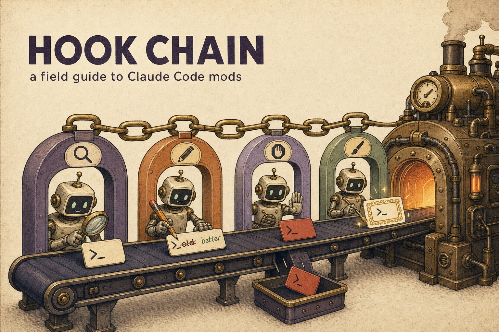

# Hook Chain: a field guide to Claude Code mods

**Read it on the web: [robgruhl.github.io/claude-mod-learnings](https://robgruhl.github.io/claude-mod-learnings/)**

Claude Code mods are TypeScript or JavaScript plugins that run inside Claude Code and hook its own event chain: tool calls, prompts, model requests, subagents and what the interface draws. They shipped on 1 October 2026 in v2.1.287. This repo teaches them from an explain-like-I'm-five version up to policy engineering, backs the claims with experiments we ran, and includes a facilitated tutorial you run in Claude Code.

It's the sister site of [Decision Tier](https://robgruhl.github.io/jev-learnings/) ([repo](https://github.com/RobGruhl/jev-learnings)), a field guide to decision models. The two meet on [Mods meet the cascade](https://robgruhl.github.io/claude-mod-learnings/cascade.html). This is an independent study, not an Anthropic project. Everything was checked against Claude Code 2.1.296 on 2026-10-12. The API is early access, so trust the declarations your own build writes over anything here.

## What's here

| Path | What it is |
| --- | --- |
| `site/pages/` | The page fragments: ELI5, 101, 201, 301, four architecture pages, three evidence pages and the tutorial page |
| `site/build.py`, `site/template.html` | Standard-library build that wraps each fragment and writes `docs/`, which GitHub Pages serves. Run `python3 site/build.py`. |
| `experiments/` | Small mods that each test one claim, run with `claude plugin test` (and one live headless probe). Results in `experiments/RESULTS.md`. Also `cascade-guard`, a tiered Bash guard. |
| `tutorial/` | **The Mod Skeleton**, a facilitated tutorial. `cd tutorial && claude` and Claude becomes your facilitator: one module at a time, predict before each check, every check run for real, one commit per module. Modelled on [walkingskeleton.org](https://walkingskeleton.org/). |
| `tutorial/.reference/skeleton-guard/` | The tutorial's finished mod, validated and tested on 2.1.296 |

## The pages

- **Learn:** [Explain like I'm five](https://robgruhl.github.io/claude-mod-learnings/eli5.html) · [101: what a mod is](https://robgruhl.github.io/claude-mod-learnings/101.html) · [201: writing mods well](https://robgruhl.github.io/claude-mod-learnings/201.html) · [301: engineering and policy](https://robgruhl.github.io/claude-mod-learnings/301.html)
- **Architecture:** [Which extension point? (mods vs skills vs MCP vs hooks vs CLAUDE.md…)](https://robgruhl.github.io/claude-mod-learnings/which.html) · [The hook chain](https://robgruhl.github.io/claude-mod-learnings/chain.html) · [What lasts how long](https://robgruhl.github.io/claude-mod-learnings/lifetimes.html) · [Mods meet the cascade](https://robgruhl.github.io/claude-mod-learnings/cascade.html)
- **Evidence:** [Field tests](https://robgruhl.github.io/claude-mod-learnings/fieldtests.html) · [The latency ladder](https://robgruhl.github.io/claude-mod-learnings/latency.html) · [Landscape, October 2026](https://robgruhl.github.io/claude-mod-learnings/landscape.html)
- **Build:** [Build your own mod skeleton](https://robgruhl.github.io/claude-mod-learnings/build.html)

## The ten-line version

1. Pick the lightest extension point that can do the job. Text goes in CLAUDE.md or a skill, tools come from MCP, and a script you already have goes in a settings hook. Reach for a mod when you need to draw, rewrite an event or run code on a command.
2. A mod is a plugin whose `hooks/hooks.json` names one module exporting `register(on, options)`. Every hook is `($, e, next)`.
3. A hook has three moves. It can observe (`return next(e)`), rewrite (`next({ ...e, … })`) or answer without calling `next`, so nothing beneath it runs.
4. Hooks run in a fixed chain: prepend (org policy), then user, append and builtin, then Claude Code itself. The result comes back up the same way.
5. A hook that throws or runs past its 10-second budget is skipped. The call goes ahead. A guard must register `.catch` to fail closed. We confirmed both cases on 2.1.296.
6. Mods aren't sandboxed. They act with your permissions. Run `claude plugin validate` on a mod before you install it and read its `calls:` line.
7. Everything outside the module goes through `$`, which is why the loader can list a mod's calls. It refuses a module that hides `$` in a destructure, an alias or a helper it can't follow.
8. There are three lifetimes. Module variables last until a reload, `$.state` until `/clear`, and `$.store` across sessions. `session.start` doesn't fire again after `/clear`, so reload from the store in `classic.SessionStart`.
9. In `claude plugin test` your test's hooks sit beneath the mod and stand in for Claude Code, so answer every event.
10. A `tool.call` guard doesn't see `@`-mentioned files. Hook `prompt.mention` too.

## Where the docs and our results differ (2.1.296)

- `setTimeout` and `setInterval` exist in the hooks runtime, though the docs say there are no timer globals. Waiting on one counts against a hook's budget.
- Two hooks on the same event with no matcher are refused, but the same matcher twice loads, and both run.
- A wrong-shape answer reaches `.catch` as `kind: 'throw'`. If the handler also answers in the wrong shape, the guard fails open anyway.
- Reserved plugin names go beyond the `claude-` prefix: `anthropic-`, `anthropics-` and `cc-plugin-` prefixes, plus exact names like `claude-code`.

Details and outputs are in [experiments/RESULTS.md](experiments/RESULTS.md).

## License

Text and illustrations © Rob Gruhl, [CC BY 4.0](https://creativecommons.org/licenses/by/4.0/). Code (the build, experiments, tutorial reference mod and code samples) is MIT; see `LICENSE`. Illustrations were made with gpt-image-2, and the site was built with Claude Code.
